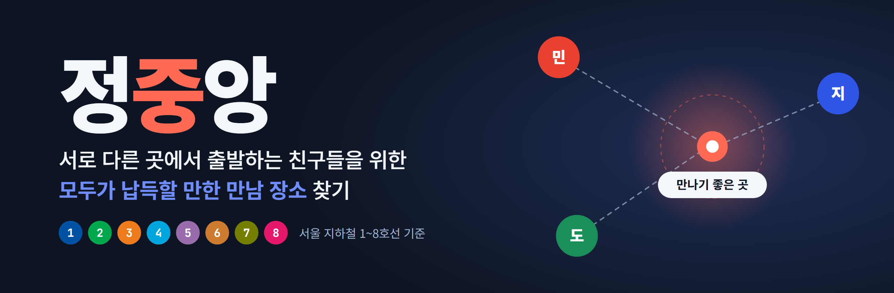
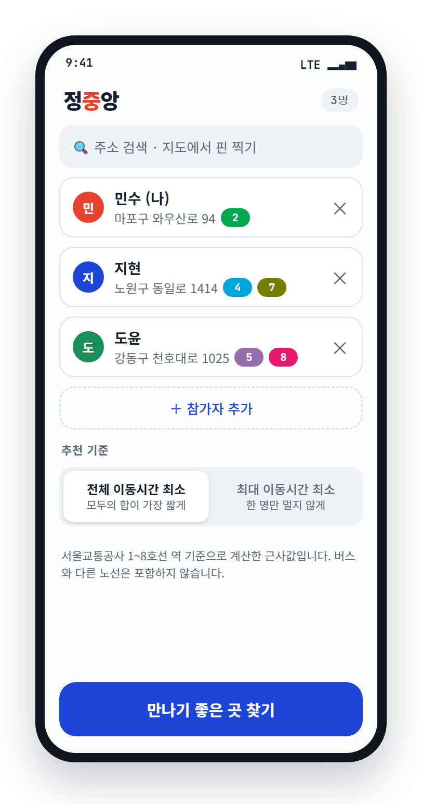
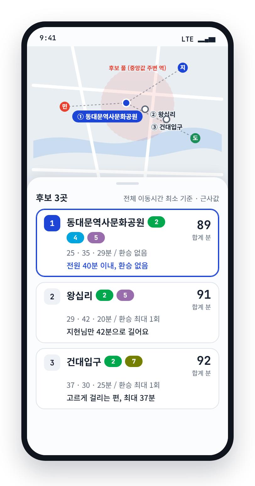
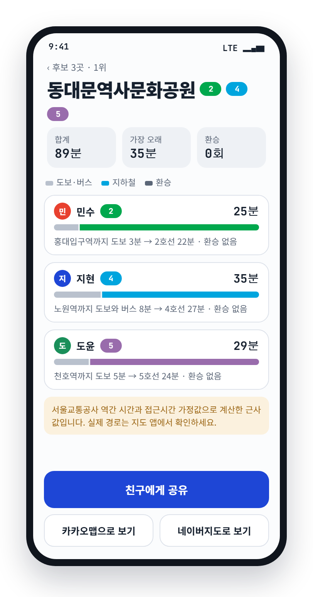
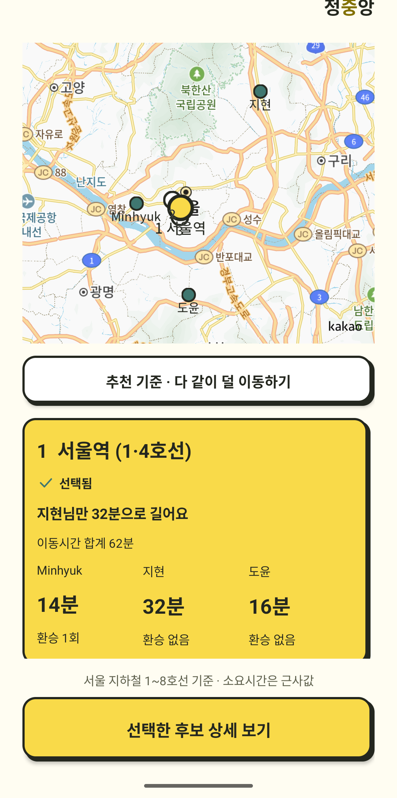
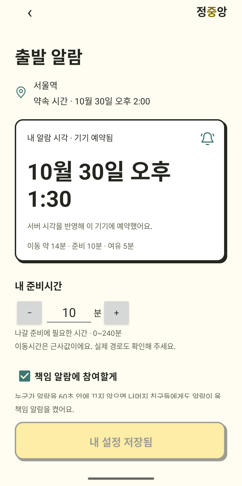
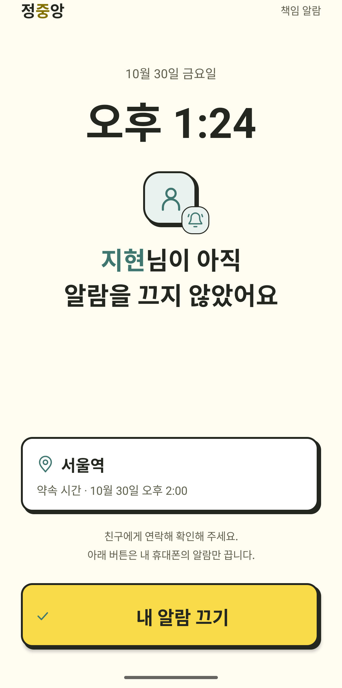
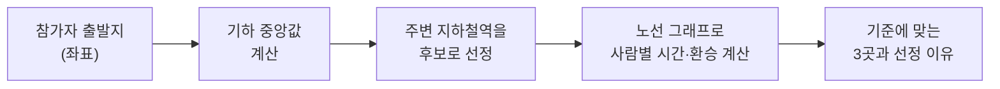
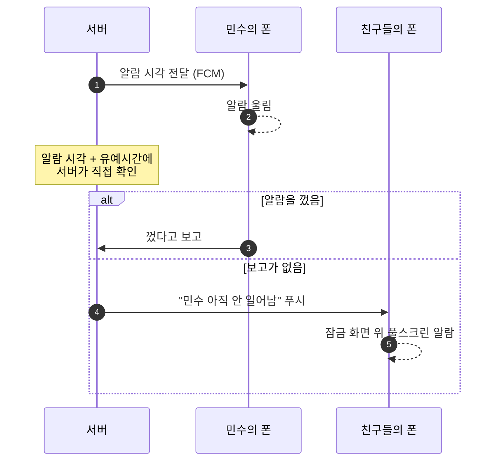

 

**[만든 이유](#만든-이유) · [사용 방법](#사용-방법) · [계산 방식](#계산-방식) · [책임 알람](#책임-알람) · [진행 상황](#진행-상황) · [개발자 정보](#개발자-정보)**

 

## 만든 이유

친구 셋이 약속을 잡습니다. 한 명은 홍대, 한 명은 노원, 한 명은 천호에 삽니다. 보통은 지도를 펴 놓고 "대충 중간이 어디지?" 하고 정합니다.

문제는 지도에서 가운데인 곳이 모두에게 가깝다는 보장이 없다는 점입니다. 직선거리는 비슷해도, 지하철로는 한 명만 환승을 두 번 하면서 한 시간을 가야 할 수 있습니다.

**정중앙은 지도상의 중간이 아니라, 지하철로 실제 얼마나 걸리는지를 기준으로 장소를 고릅니다.** 아래 예시에서는 세 사람이 각각 25분, 35분, 29분이면 닿는 동대문역사문화공원을 1위로 추천합니다.

 

## 사용 방법

### 혼자 바로 찾기

<table>
  <tr>
    <td align="center" width="33%"></td>
    <td align="center" width="33%"></td>
    <td align="center" width="33%"></td>
  </tr>
  <tr>
    <td align="center"><b>1. 출발지 입력</b></td>
    <td align="center"><b>2. 후보 3곳</b></td>
    <td align="center"><b>3. 비교하고 공유</b></td>
  </tr>
  <tr>
    <td valign="top">한 사람이 모두의 출발지를 주소 검색이나 지도 핀으로 넣고, 추천 기준을 고릅니다.</td>
    <td valign="top">지도와 카드로 후보 3곳이 나옵니다. 사람별 시간, 환승 횟수, 선정 이유가 함께 보입니다.</td>
    <td valign="top">걷는 구간, 지하철 구간, 환승 구간을 사람별로 비교하고 카카오맵·네이버지도로 확인한 뒤 친구에게 공유합니다.</td>
  </tr>
</table>

> 위 세 장은 초기 화면 시안이고, 사람·역·소요시간은 예시입니다. 실제 앱 화면은 아래에 있습니다.

### 약속 만들고 함께 정하기

1. **약속 만들기**: 약속 이름, 시간, 목적(식사·카페·술자리·기타)을 정하면 초대 링크가 만들어집니다.
2. **초대**: 친구가 링크를 누르면 앱이 바로 열립니다(앱이 없으면 안내 페이지). 로그인 없이 참가합니다.
3. **각자 출발지 입력**: 참가자가 자기 출발지를 넣으면 약속 화면에 모두의 상태가 바로 보입니다.
4. **추천과 확정**: 모두의 출발지로 후보 3곳을 계산하고, 방장이 한 곳을 확정합니다.
5. **주변 장소**: 확정한 역 주변의 식당·카페·술집을 약속 목적에 맞춰 지도와 함께 보여 줍니다.
6. **출발 알람**: 원하면 [책임 알람](#책임-알람)을 켭니다.

<table>
  <tr>
    <td align="center" width="33%"></td>
    <td align="center" width="33%"></td>
    <td align="center" width="33%"></td>
  </tr>
  <tr>
    <td align="center"><b>추천 결과 · 지도</b></td>
    <td align="center"><b>출발 알람 설정</b></td>
    <td align="center"><b>친구 알람 화면</b></td>
  </tr>
</table>

> 실제 앱 화면입니다(운영 서버 연결, 에뮬레이터). 아직 스토어에 올리지 않아 설치해서 쓸 수는 없습니다.

추천 기준은 두 가지 중에 고릅니다.

| 기준 | 이럴 때 |
|:---|:---|
| **전체 이동시간 최소** | 모두의 이동시간 합이 가장 짧은 곳. 전체 부담을 줄이고 싶을 때 |
| **최대 이동시간 최소** | 가장 오래 걸리는 사람이 가장 짧은 곳. 한 명만 너무 멀지 않게 하고 싶을 때 |

 

## 계산 방식

1. 참가자 좌표들의 **기하 중앙값**(모든 사람까지의 거리 합이 가장 작은 점)을 구합니다.
2. 그 주변 지하철역을 후보로 뽑습니다.
3. 서울교통공사 공개 데이터로 만든 노선 그래프에서, 사람마다 출발지 근처 역부터 각 후보역까지 걸리는 시간과 환승 횟수를 계산합니다.
4. 고른 기준에 가장 잘 맞는 3곳을 선정 이유와 함께 보여 줍니다. 기준 시간이 2분 이내로 비슷하면 환승이 적은 곳을 앞에 둡니다.

계산은 서버 없이 폰 안에서 합니다. 계산한 시간은 근사값이고, 화면에도 그렇게 표시합니다. 한계는 [알아둘 점](#알아둘-점)에 있습니다.

 

## 책임 알람

약속 장소와 시간이 정해지면, 사람마다 출발 알람을 자동으로 걸어 줍니다.

> **알람 시각 = 약속 시간 − 그 사람의 이동시간 − 준비 시간 − 여유 시간(기본 5분)**

알람이 울린 뒤 정해진 시간(기본 60초) 안에 끄지 않으면 같은 약속 멤버 전원의 폰이 울리고, "○○님이 아직 알람을 끄지 않았어요" 화면이 뜹니다.

- 서버가 따로 시간을 재기 때문에, 늦잠 잔 사람의 폰이 꺼져 있거나 오프라인이어도 동작합니다.
- 알람을 끄고 보고하지 못했으면(네트워크 끊김) 기록을 쌓아 뒀다가 다시 보내고, "이미 일어났어요" 버튼도 있습니다.
- 약속 멤버 **전원이 동의했을 때만** 켜집니다.
- 안드로이드에서만 지원합니다.
- 자세한 설계는 [CLAUDE.md](CLAUDE.md)의 "확장: 책임 알람"과 [docs/API.md](docs/API.md) 7절에 있습니다.

 

## 진행 상황

| 단계 | 내용 | 상태 |
|:---|:---|:---:|
| 1 | 추천 코어: 기하 중앙값, 서울 지하철 1~8호선 그래프(역 240개), 최단시간·환승 탐색, 후보 3곳과 선정 이유 | ✅ 완료 |
| 1 | 화면: 출발지 입력(주소 검색·지도 핀), 추천 결과, 사람별 비교, 공유, 카카오맵·네이버지도 길찾기, 지원 지역(3km) 판정 | ✅ 완료 |
| 2 | 약속·초대: 초대 링크로 앱 바로 열기, 각자 출발지 입력, 장소 확정, 내 약속 목록 | ✅ 완료 |
| 2 | 약속 목적별 주변 장소(식사·카페·술자리)와 지도 | ✅ 완료 |
| 2 | 서버 운영 배포: AWS EC2, HTTPS, main에 합치면 자동 배포 | ✅ 완료 |
| 3 | 책임 알람: 기기 알람, 서버 스케줄러, FCM 동기화·친구 호출 | ✅ 완료 |
| 3 | 실기기 테스트 (삼성, Android 14 이상, 배터리 최적화) | ⏳ 예정 |
| 이후 | 주변 장소 추천 개선, ODsay로 1위 후보 검증, 다른 운영기관 노선 | 후순위 |

테스트: 앱 단위 테스트 216개 + 기기 테스트 2개, 서버 테스트 99개. 서버 테스트는 PR마다 GitHub Actions에서 자동으로 돕니다.

앱 쪽 작업 정리와 팀원별로 알아야 할 것은 [docs/HANDOFF.md](docs/HANDOFF.md)에 있습니다.

 

## 알아둘 점

| 항목 | 내용 |
|:---|:---|
| **지원 노선** | 서울교통공사 1~8호선만 지원합니다. 9호선, 신분당선, 분당선, 경의중앙선, 공항철도는 지원하지 않습니다. 1호선은 서울역~청량리 구간만 포함됩니다. |
| **지원 지역** | 가장 가까운 1~8호선 역이 3km보다 먼 출발지는 받지 않습니다. 서울 안은 대부분 들어가고, 경기도는 판교부터 막힙니다. |
| **버스** | 계산에 넣지 않습니다. 출발지에서 역까지의 접근 구간만 걷기·버스 가정값으로 추정합니다. |
| **소요시간** | 근사값입니다. 공개 데이터에는 정차시간이 빠져 있어 역마다 30초로 가정해 더했고, 출발지에서 역까지의 접근 시간도 가정값입니다. 실제 경로는 지도 앱에서 확인하는 걸 권장합니다. |
| **주변 장소** | 카카오 로컬 검색 결과를 역에서 가까운 순으로 보여 줍니다. 평점·리뷰는 반영하지 않습니다. |
| **플랫폼** | 안드로이드 전용입니다. |

 

---

## 개발자 정보

### 기술 스택

| 영역 | 사용 |
|:---|:---|
| Android | Java(Kotlin 사용 안 함), XML + ViewBinding, MVVM + ViewModel + LiveData, ExecutorService/Handler, OkHttp, WorkManager |
| 지도·주소 | 카카오맵 SDK, 카카오 로컬(서버 경유) |
| 서버 | Spring Boot 3.5 / Java 17, PostgreSQL 16(Flyway), Redis, FCM HTTP v1 |
| 배포 | Docker Compose + Caddy(HTTPS), AWS EC2, DuckDNS, GitHub Actions |
| 데이터 | 서울 열린데이터광장 CSV 3종(앱에 번들) |

### 폴더 구조

| 경로 | 내용 |
|:---|:---|
| `android/app/src/main/java/com/jeongjungang/domain` | 순수 Java 코어. `geo`(기하 중앙값), `transit`(CSV 파서, 지하철 그래프, 최단시간, 접근시간), `recommend`(후보 3곳, 선정 이유), `alarm`(알람 시각 계산) |
| `android/app/src/main/java/com/jeongjungang/data` | 서버 호출(`remote`), 지하철 데이터·약속·토큰·책임 알람 저장소(`repository`) |
| `android/app/src/main/java/com/jeongjungang/ui` | 화면(Activity)과 ViewModel(`recommend`, `search`, `meeting`), 알람 화면(`alarm`), 지도(`map`) |
| `android/app/src/main/java/com/jeongjungang/alarm` | 기기 알람 예약·울림·재부팅 재예약, 끔 기록 재전송 |
| `android/app/src/main/java/com/jeongjungang/push` | FCM 수신, 기기 등록, 알람 동기화 |
| `android/app/src/main/java/com/jeongjungang/util` | 공유 문구, 카카오맵·네이버지도 링크 |
| `android/app/src/main/assets/data` | 번들 CSV (역간 소요시간, 역사 좌표, 환승) |
| `backend` | Spring Boot 서버. `meeting`(약속·참가자), `alarm`(책임 알람, 에스컬레이션 스케줄러), `push`(FCM), `geocode`(카카오 로컬 대리 호출), `auth`, `ratelimit` |
| `deploy` | 운영 배포 구성 (Caddy + 앱 + Postgres + Redis), 초대 안내 페이지 |
| `docs/API.md` | 서버 API 명세 (서버와 앱 모두 이 문서가 기준) |
| `docs/DEPLOY.md` | 서버 배포 방법 |
| `docs/DATA.md` | 데이터 출처와 파싱 주의점 |
| `docs/HANDOFF.md` | 앱 쪽 작업 정리, 팀원별 안내 |
| `docs/mockup`, `docs/images` | UI 시안 HTML과 README용 이미지 |
| `CLAUDE.md` | 프로젝트 규칙과 설계 |

### 개발 환경

- JDK 17
- 안드로이드: Android Studio에서 `android/` 폴더를 엽니다. 프로젝트 경로에 한글이 있으면 빌드가 실패하니 영문 경로에 두세요.
- 안드로이드 설정: `android/local.properties`(git에 안 올라감)에 서버 주소 `jeongjungang.apiBaseUrl`과 카카오 키 `jeongjungang.kakaoNativeAppKey`를 넣습니다. 키가 없으면 지도만 꺼지고 나머지는 동작합니다. 자세한 건 [docs/HANDOFF.md](docs/HANDOFF.md)를 보세요.
- 안드로이드 단위 테스트: `cd android && gradlew.bat test` (macOS/Linux는 `./gradlew test`). Gradle 데몬이 JDK 25를 요구해서 `JAVA_HOME`을 Android Studio 내장 JDK(`.../Android Studio/jbr`)로 지정해야 합니다. 코어 코드는 Android 의존성이 없어서 JUnit4만으로도 실행할 수 있습니다.
- 백엔드: `cd backend && gradlew.bat bootRun`. Docker Desktop이 켜져 있으면 Postgres·Redis가 자동으로 뜹니다. 테스트는 `gradlew.bat test`.
- README 이미지 원본은 [`docs/mockup/ui-mockup.html`](docs/mockup/ui-mockup.html)(화면 시안)과 [`docs/mockup/banner.html`](docs/mockup/banner.html)(배너)이며, Chrome headless로 캡처했습니다.

API 키(카카오 REST 키, FCM 서비스 계정, DB 비밀번호 등)는 저장소에 두지 않습니다. 서버 환경변수나 `local.properties`로만 주입하고, 외부 API 키가 필요한 호출은 서버를 거칩니다.

### 데이터 출처

지하철 데이터는 [서울 열린데이터광장](https://data.seoul.go.kr)의 서울교통공사 제공 자료이며 **공공누리 1유형(출처표시)** 입니다.

- 서울교통공사 역간 거리 및 소요시간 정보
- 서울교통공사 1-8호선 역사 좌표(위경도) 정보
- 서울교통공사 환승역거리 소요시간 정보

기준일과 가공 내용은 [docs/DATA.md](docs/DATA.md)를 보세요.

 

준하가똥마렵데 - 참 슬픈 일이구나

